# urbuddy

<p align="center"></p>

Personal language intelligence for non-native English-speaking
professionals: follow live meetings in real time, get contextual
English–Indonesian comprehension help, and turn daily conversations
into lasting language progress — with data under the user's control.
See [docs/product.md](./docs/product.md) for the vision,
[docs/roadmap.md](./docs/roadmap.md) for the delivery sequence, and
[docs/architecture.md](./docs/architecture.md) for the system design.
Working conventions live in [AGENTS.md](./AGENTS.md).

## Status

Application Foundation is merged (`0.1.0`); Core Runtime is next. See
[docs/roadmap.md](./docs/roadmap.md) for milestones and acceptance gates.

## The problem

Fast, accented, overlapping English in a live meeting leaves no time
to translate, look up a term, or ask for repetition. Subtitles built
for recorded video arrive too late and rewrite themselves while you
read. What a non-native listener needs is not a transcript — it is
understanding, at the speed of the conversation.

## The transformation

<p align="center"></p>

Urbuddy turns hard-to-follow spoken English into stable, contextual
understanding: provisional captions while speech is in flight,
committed translations that preserve negation, numbers, commitments,
and technical terms. The example above is an illustrative mock, not
captured output.

## Capabilities

<p align="center"></p>

Four planned capabilities, one per product workflow
([docs/product.md](./docs/product.md)): live bilingual captions,
contextual translation, missed-context catch-up, and a personal
vocabulary that grows from real meetings. What ships today is the
foundation: typed errors, validated configuration, resource
lifecycle, CLI, and smoke paths.

## Under the hood

<p align="center"></p>

A real-time data plane (capture → perception → language → terminal,
evidence) that keeps running when intelligence, memory, or learning
fail. Supervisory workflows stay off the hot path; graph memory is
derived and rebuildable. Full design in
[docs/architecture.md](./docs/architecture.md).

## Roadmap

<p align="center"></p>

Foundation is done; Core Runtime (offline session replay, then
durable persistence) is next. Tracked in
[docs/roadmap.md](./docs/roadmap.md) with acceptance gates per
milestone.

## Getting started

### Requirements

Node >= 24 (repo targets the Node 24 line; `.nvmrc` pins 24).

### Quickstart

```sh
pnpm install --frozen-lockfile
pnpm check
pnpm smoke
pnpm doctor
pnpm ink-smoke
```

### Scripts

| script                    | purpose                                                     |
| ------------------------- | ----------------------------------------------------------- |
| `check`                   | aggregate gate: typecheck, lint, test, cruise, knip, format |
| `typecheck`               | `tsc --noEmit` under the strict baseline                    |
| `build`                   | emit to `dist/` + `tsc-alias` rewrite + dist verify         |
| `test`                    | vitest, deterministic (seeded properties)                   |
| `test:coverage`           | v8 coverage over `src/`                                     |
| `lint`                    | eslint flat config                                          |
| `format` / `format:write` | prettier check / write                                      |
| `cruise`                  | dependency-cruiser layer rules                              |
| `knip`                    | unused export / file detection                              |
| `smoke` / `doctor`        | run `doctor` via tsx (text / `--json`)                      |
| `ink-smoke`               | run the Ink startup/shutdown path via tsx                   |
| `brand`                   | regenerate the `assets/brand` artwork                       |

### System Anatomy

| Directory              | Responsibility                                     | Source                             |
| ---------------------- | -------------------------------------------------- | ---------------------------------- |
| `src/bootstrap`        | Composition root and application entry             | [bootstrap](./src/bootstrap)       |
| `src/kernel`           | Errors, identity, lifecycle, and shared primitives | [kernel](./src/kernel)             |
| `src/modules/config`   | Validated session configuration                    | [config](./src/modules/config)     |
| `src/modules/security` | Default-deny security policy                       | [security](./src/modules/security) |
| `src/modules/session`  | Session runtime: ordering, revisions, gaps         | [session](./src/modules/session)   |
| `src/platform`         | Infrastructure, logging, paths, and output         | [platform](./src/platform)         |
| `src/presentation`     | Commander CLI and Ink terminal                     | [presentation](./src/presentation) |
| `tests/`               | Behavioral verification                            | [tests](./tests)                   |
| `docs/`                | Canonical project knowledge and decisions          | [docs](./docs)                     |
| `assets/brand/`        | Generated visual identity                          | [brand](./assets/brand)            |
| `tooling/`             | Developer tooling and artwork generation           | [tooling](./tooling)               |

Only implemented directories are listed. Planned modules stay out of
this table until they exist. Implemented catalogs live in
[docs/catalogs.md](./docs/catalogs.md); every dependency with rationale
and ownership in [docs/dependencies.md](./docs/dependencies.md).
`tooling/generate-brand.mjs` (Node standard library only,
deterministic) regenerates the artwork via `pnpm brand`.

### Control Panel

Configuration precedence, highest priority last:

built-in defaults → environment variables → CLI flags → profile
security ceiling → validated session configuration.

A profile can only restrict: no flag, variable, or profile grants a
permission the ceiling denies. Forbidden grants fail fast.

| Environment variable   | CLI override     |
| ---------------------- | ---------------- |
| `URBUDDY_PROFILE`      | `--profile`      |
| `URBUDDY_LOG_LEVEL`    | `--log-level`    |
| `URBUDDY_DATA_ROOT`    | `--data-root`    |
| `URBUDDY_ALLOW_EGRESS` | `--allow-egress` |
| `URBUDDY_ALLOW_CHILD`  | `--allow-child`  |

Available profiles: `development`, `simulation`, `evaluation`,
`personal`, `offline`. Forbidden grants return `CONFIG_INVALID` (exit
code 3). Validation rejects bad configuration; runtime enforcement
happens at the operation boundary, not in the parser.

<p align="center"></p>
