# urbuddy

<p align="center"></p>

Personal language intelligence for non-native English-speaking
professionals: follow live meetings in real time, get contextual
English–Indonesian comprehension help, and turn daily conversations
into lasting language progress — with data under the user's control.
See [docs/product.md](./docs/product.md) for the vision,
[docs/roadmap.md](./docs/roadmap.md) for the delivery sequence, and
[docs/architecture.md](./docs/architecture.md) for the system design.
Working conventions live in [AGENTS.md](./AGENTS.md).

## Status

Application Foundation and Core Runtime are merged. Speech Perception
completed its initial implementation gate, including an owner-authorized
Muse run series. Production latency, rotation, endurance, and recognition
accuracy remain open. Live Language Engine is in progress. Luna and Terra
both published all finals in the transcript-only comparison. Neither
met the frozen semantic criteria. Human bilingual review and live
preview qualification remain open.
See the [roadmap](./docs/roadmap.md) and [translation evaluation guide](./evaluation/language/README.md).

## The problem

Fast, accented, overlapping English in a live meeting leaves no time
to translate, look up a term, or ask for repetition. Subtitles built
for recorded video arrive too late and rewrite themselves while you
read. What a non-native listener needs is not a transcript — it is
understanding, at the speed of the conversation.

## The transformation

<p align="center"></p>

Urbuddy turns hard-to-follow spoken English into stable, contextual
understanding: provisional captions while speech is in flight,
committed translations that preserve negation, numbers, commitments,
and technical terms. The example above is an illustrative mock, not
captured output.

## Capabilities

<p align="center"></p>

Four planned capabilities, one per product workflow
([docs/product.md](./docs/product.md)): live bilingual captions,
contextual translation, missed-context catch-up, and a personal
vocabulary that grows from real meetings. What ships today is the
foundation — typed errors, validated configuration, resource
lifecycle, CLI, and smoke paths — plus the first Core Runtime slice:
deterministic offline session replay through the `replay` command.
Core Runtime stays in progress until durable persistence lands.

## Under the hood

<p align="center"></p>

A real-time data plane (capture → perception → language → terminal,
evidence) that keeps running when intelligence, memory, or learning
fail. Supervisory workflows stay off the hot path; graph memory is
derived and rebuildable. Full design in
[docs/architecture.md](./docs/architecture.md).

## Roadmap

<p align="center"></p>

Foundation and Core Runtime (offline session replay, durable
persistence) are done; Speech Perception native audio acquisition is
merged and streaming speech recognition is in review. Tracked in
[docs/roadmap.md](./docs/roadmap.md) with acceptance gates per
milestone.

## Getting started

### Requirements

Node >= 24 (repo targets the Node 24 line; `.nvmrc` pins 24).
Audio capture additionally needs macOS with Xcode command line tools
(`swiftc`) and `pnpm native:build`.

### Quickstart

```sh
pnpm install --frozen-lockfile
pnpm check
pnpm smoke
pnpm doctor
pnpm ink-smoke
pnpm exec tsx src/bootstrap/main.ts replay fixtures/replay/basic.ndjson
pnpm native:build # macOS only; builds the audio capture helper
pnpm exec tsx src/bootstrap/main.ts capture --synthetic-frames 200 --duration 10 --allow-child
# Streaming transcription needs a credential and explicit egress. WAV
# input is paced as a live stream; live capture also needs --allow-child.
pnpm exec tsx src/bootstrap/main.ts --env-file .env transcribe --file sample.wav --allow-egress
```

### Scripts

| script                    | purpose                                                     |
| ------------------------- | ----------------------------------------------------------- |
| `check`                   | aggregate gate: typecheck, lint, test, cruise, knip, format |
| `typecheck`               | `tsc --noEmit` under the strict baseline                    |
| `build`                   | emit to `dist/` + `tsc-alias` rewrite + dist verify         |
| `test`                    | vitest, deterministic (seeded properties)                   |
| `test:coverage`           | v8 coverage over `src/`                                     |
| `lint`                    | eslint flat config                                          |
| `format` / `format:write` | prettier check / write                                      |
| `cruise`                  | dependency-cruiser layer rules                              |
| `knip`                    | unused export / file detection                              |
| `smoke` / `doctor`        | run `doctor` via tsx (text / `--json`)                      |
| `ink-smoke`               | run the Ink startup/shutdown path via tsx                   |
| `brand`                   | regenerate the `assets/brand` artwork                       |

### System Anatomy

| Directory                    | Responsibility                                           | Source                                        |
| ---------------------------- | -------------------------------------------------------- | --------------------------------------------- |
| `src/bootstrap`              | Composition root and application entry                   | [bootstrap](./src/bootstrap)                  |
| `src/kernel`                 | Errors, identity, lifecycle, and shared primitives       | [kernel](./src/kernel)                        |
| `src/modules/config`         | Validated session configuration                          | [config](./src/modules/config)                |
| `src/modules/security`       | Default-deny security policy                             | [security](./src/modules/security)            |
| `src/modules/session`        | Session runtime: ordering, revisions, gaps               | [session](./src/modules/session)              |
| `src/modules/perception`     | Audio contracts and capture orchestration                | [perception](./src/modules/perception)        |
| `src/modules/language`       | Translation units, scheduling, glossary                  | —                                             |
| `src/adapters/audio`         | Native helper supervision and frame decoding             | [audio](./src/adapters/audio)                 |
| `src/adapters/speech`        | Muse streaming speech provider (WebSocket)               | [speech](./src/adapters/speech)               |
| `src/adapters/translation`   | OpenAI translation provider (LangChain)                  | —                                             |
| `native/audio-capture-macos` | Swift Core Audio Tap helper (macOS, `pnpm native:build`) | [audio-capture](./native/audio-capture-macos) |
| `src/platform`               | Infrastructure, logging, paths, and output               | [platform](./src/platform)                    |
| `src/presentation`           | Commander CLI and Ink terminal                           | [presentation](./src/presentation)            |
| `tests/`                     | Behavioral verification                                  | [tests](./tests)                              |
| `docs/`                      | Canonical project knowledge and decisions                | [docs](./docs)                                |
| `assets/brand/`              | Generated visual identity                                | [brand](./assets/brand)                       |
| `tooling/`                   | Developer tooling and artwork generation                 | [tooling](./tooling)                          |

Only implemented directories are listed. Planned modules stay out of
this table until they exist. Implemented catalogs live in
[docs/catalogs.md](./docs/catalogs.md); every dependency with rationale
and ownership in [docs/dependencies.md](./docs/dependencies.md).
`tooling/generate-brand.mjs` (Node standard library only,
deterministic) regenerates the artwork via `pnpm brand`.

### Control Panel

Configuration precedence, highest priority last:

built-in defaults → explicitly selected environment file → process environment →
explicit CLI flags. Effective permissions remain subject to the profile ceiling.

A profile can only restrict: no flag, variable, or profile grants a
permission the ceiling denies. Forbidden grants fail fast.

| Environment variable                  | CLI override                                                                                             |
| ------------------------------------- | -------------------------------------------------------------------------------------------------------- |
| `URBUDDY_PROFILE`                     | `--profile`                                                                                              |
| `URBUDDY_LOG_LEVEL`                   | `--log-level`                                                                                            |
| `URBUDDY_DATA_ROOT`                   | `--data-root`                                                                                            |
| `URBUDDY_ALLOW_EGRESS`                | `--allow-egress`                                                                                         |
| `URBUDDY_ALLOW_CHILD`                 | `--allow-child`                                                                                          |
| `URBUDDY_AUDIO_HELPER`                | (no flag; absolute path override for the native helper binary)                                           |
| `URBUDDY_TRANSCRIBE_ENDPOINT`         | (no flag; loopback-only WebSocket URL for local smoke/test servers; production uses `wss://api.meta.ai`) |
| `URBUDDY_STT_PROVIDER`                | `--provider` (Muse)                                                                                      |
| `URBUDDY_STT_MODEL`                   | `--stt-model` (`muse-voice-transcribe-1.0`)                                                              |
| `URBUDDY_TRANSLATION_PROVIDER`        | `--translation-provider`                                                                                 |
| `URBUDDY_TRANSLATION_MODEL`           | `--translation-model`                                                                                    |
| `URBUDDY_TRANSLATION_SOURCE_LANGUAGE` | `--source-language`                                                                                      |
| `URBUDDY_TRANSLATION_TARGET_LANGUAGE` | `--target-language`                                                                                      |
| `URBUDDY_META_API_KEY`                | Provider credential with no CLI argument                                                                 |
| `URBUDDY_OPENAI_API_KEY`              | Provider credential with no CLI argument                                                                 |
| `URBUDDY_TRANSLATE_ENDPOINT`          | (no flag; loopback-only HTTP URL for local smoke/test servers; production uses `https://api.openai.com`) |

Create the local file only if `.env` is absent.

```sh
cp .env.example .env
chmod 600 .env
```

Supply the provider keys locally. Migrate `MODEL_API_KEY` to
`URBUDDY_META_API_KEY` and `OPENAI_API_KEY` to `URBUDDY_OPENAI_API_KEY`.
Remove the legacy names after migration. An explicitly empty process value
overrides the file value. The local file is plaintext and ignored by Git.
Keep it private. Urbuddy reads it only when named with `--env-file`. The
file accepts the eight variables in [the example](.env.example). Authorization,
endpoint overrides, Node options, and tracing cannot be configured through it.

Translation requires `--translate` and effective egress. The provider and
language values alone leave it off. Muse recognition settings are independent
of translation source interpretation.

```sh
pnpm build
node dist/bootstrap/main.js --env-file .env transcribe --translate --allow-egress --allow-child
```

Use `--allow-child` for native capture. See [translation contracts](docs/decisions/007-live-language-engine.md)
and the [authored evaluation corpus](evaluation/language/README.md) for model and test scope.

Available profiles: `development`, `simulation`, `evaluation`,
`personal`, `offline`. Forbidden grants return `CONFIG_INVALID` (exit
code 3). Validation rejects bad configuration; runtime enforcement
happens at the operation boundary, not in the parser.

Persistent replay is opt-in per run: `replay <fixture> --persist`
additionally requires the native-module grant (`--allow-native`,
development/personal profiles only) and writes `evidence.sqlite`
(WAL, synchronous FULL) under the data root. Add
`--operation-id <id>` to make a persistent replay an idempotent retry
of the same logical operation.

Audio capture is opt-in per run: `capture --duration 30 --allow-child`
runs the native helper (`native/audio-capture-macos`, macOS only)
through the perception runtime with bounded buffering and explicit
gap accounting. The helper captures system-wide mixdown audio;
without audible content the run reports no signal instead of
pretending silence. `--synthetic-frames N`
exercises the same transport deterministically for tests and is
always labeled as a transport test.

<p align="center"></p>
